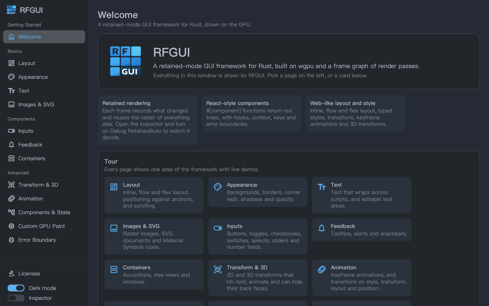

# 🧩 RFGUI

<div style="text-align: center;">
    <h3>
        <a href="https://jakehuang2232.github.io/rfgui/">Demo</a>
    </h3>
    <abbr>(Since WASM cannot release allocated memory back to OS, it is not recommended to use the web version of RFGUI)</abbr>
</div>



**RFGUI** is a **🦀 Rust-based retained-mode GUI framework** built on top of a **🧠 frame graph–driven rendering architecture**.

It is designed for developers who want **🎛 explicit control over rendering passes**, predictable performance, and a **📐 modern retained UI model**, rather than an immediate-mode GUI.

RFGUI treats UI rendering as a **🔗 directed acyclic graph (DAG) of render passes**, similar to frame graph systems used in modern game engines.  
Each UI component records what it paints; the engine works out which content can reuse a raster from an earlier frame and compiles the rest into render passes and resources, scheduled automatically.

## ✨ Key Characteristics

- 🧱 **Retained-mode GUI** — UI state is preserved and updated declaratively, instead of redrawn every frame
- 🧠 **Frame Graph architecture** — rendering is expressed as connected render passes with explicit resource dependencies
- ♻️ **Retained paint** — content that did not change reuses its raster; only what cannot be reused is drawn again
- 🧮 **Deterministic rendering order** — pass execution is derived from graph topology, not ad-hoc draw calls
- 🗂 **Explicit resource management** — textures, buffers, and render targets are modeled as graph resources
- 🚀 **Designed for modern GPU APIs** — suitable for rendering backends

RFGUI is **not** an immediate-mode GUI like egui or imgui.  
It is closer in spirit to **🏗 retained UI frameworks combined with 🎮 engine-style render pipelines**.

🛠 This project is under active development and in alpha: APIs still change between releases. It focuses on **core architecture, correctness, and composability**; a widget library, `rfgui-components`, lives in this repository.

## Features

- `wgpu` rendering pipeline, on desktop and in the browser through WebAssembly
- RSX-style UI declaration via `rfgui-rsx`
- `#[component]` functions with typed props, children and hooks (`use_state`, `use_context`, `use_mount`, …), with local and global keys
- Layout: flow, flex and inline formatting with baselines; absolute positioning anchored to other elements, with collision handling; scrolling
- Text shaping and wrapping across scripts, selection, and an editable `TextArea` with IME, clipboard and projections (ranges of the text rendered as elements)
- Typed styles: per-side borders, per-corner radii, gradients, box shadows, group opacity, 2D and 3D transforms with back-face hiding
- Keyframe animations and style transitions, including size and position
- Pointer, wheel, keyboard and focus events that bubble up the tree as in the DOM
- Error boundaries that catch a panicking component (desktop)
- Custom paint through typed retained hooks, including engine-scheduled GPU sources (`GpuPaintSource`)
- Frame Graph abstraction for pass/resource orchestration
- Built-in interaction primitives: hover, scroll, bubbling events, transitions

## Quick Start

### Requirements

- Rust (stable recommended)
- A graphics-capable environment (macOS / Linux / Windows), or a browser for the WebAssembly build

### Run the demos

```bash
cargo run -r -p examples --bin 01_window
cargo run -r -p examples --bin 00_hello_world
```

`01_window` is the feature showcase: a sidebar of pages for layout, appearance, text, images and SVG, inputs, feedback, containers, transforms and 3D, animation, component state, custom GPU paint and error boundaries. The floating Inspector toggles dark mode, animations, render-time tracing and the debug overlays.

### Use it in a project

```bash
cargo add rfgui
```

An app implements `App`, whose `build` returns the tree to show:

```rust
use rfgui::app::{App, AppContext};
use rfgui::style::{Layout, Length};
use rfgui::ui::{ClickEvent, RsxNode, component, rsx, use_state};
use rfgui::view::{Element, Text};

#[component]
fn Counter(label: String) -> RsxNode {
    let count = use_state(|| 0);
    let increment = {
        let count = count.clone();
        move |_: &mut ClickEvent| count.update(|n| *n += 1)
    };
    rsx! {
        <Element style={{ layout: Layout::flow().column(), width: Length::px(200.0) }} on_click={increment}>
            <Text>{format!("{label}: {}", count.get())}</Text>
        </Element>
    }
}

struct CounterApp;

impl App for CounterApp {
    fn build(&mut self, _ctx: &mut AppContext<'_>) -> RsxNode {
        rsx! { <Counter label="Clicks" /> }
    }
}
```

`rfgui` does not open windows itself. A runner hosts the app: the examples' `winit_runner` opens a native window and `web_runner` a browser canvas, both in `examples/src/`. Copy one into your project, or host a `Viewport` yourself (see [Rendering](#rendering)). `rfgui-components` is not on crates.io yet; depend on it by path or git.

## Project Layout

```text
.
├── src/
│   ├── app.rs         # the App trait and configuration a runner hosts
│   ├── platform/      # input types and the desktop, web and headless backends
│   ├── style/         # typed style model + parsing/computation
│   ├── ui/            # RSX tree, components, hooks, events
│   ├── view/          # elements, layout, viewport, paint recording, compositor, frame graph
│   ├── transition/    # animation/transition system
│   ├── time/          # timers
│   └── shader/        # WGSL shaders
├── rsx-macro/         # rfgui-rsx: the rsx! and #[component] proc macros
├── lib/
│   ├── rfgui-components/  # widget library
│   └── rfgui-segmenter/   # word, grapheme and line-break segmentation
├── examples/          # runnable demos and the winit / web runners
└── tests/             # integration tests and benchmarks
```

## Style Model

- Parsed Style: typed external style input (`PropertyId` + typed values)
- ComputedStyle: structured engine-level style (no string parsing)
- LayoutState: solver output only (position/size/baseline, etc.)

## Rendering Pipeline

Every frame goes through one pipeline, `RetainedAuto`:

1. **Layout** measures and places the node arena.
2. **Paint recording** captures what each node paints as typed paint operations (`src/view/paint/`). Transforms, clips, scrolling, and opacity live in compositor property trees (`src/view/compositor/`).
3. **Raster planning** groups the content into surfaces and keeps a surface's raster from an earlier frame when nothing it depends on changed. Content that cannot be reused is drawn again this frame.
4. **Frame Graph** compiles the remaining raster and composite work into render passes and executes them on `wgpu`.

Kept surfaces are only a cache. A surface the cache cannot keep, for example past its 128 MiB budget, is drawn into a frame-local texture and dropped after the frame; nothing falls back to another renderer or skips a frame. If compiling or executing the graph fails, the frame is discarded and the next frame paints again.

To see what the cache did, enable `ViewportDebugOptions::retained_auto_overlay` (or `RFGUI_DEBUG_RETAINED_AUTO=1`): every surface is outlined on its owner node in green (reused), orange (drawn again and kept) or red (drawn and not kept), labelled with its size and raster scale. In the example runner, F9 prints the same information for the next frame.

## Frame Graph

`src/view/frame_graph/` manages render-stage dependencies and resources.

Key files:
- `frame_graph.rs` (core graph/execution)
- `builder.rs` (graph construction)
- `render_node.rs` (node contracts)
- `texture_resource.rs`, `buffer_resource.rs` (resources)
- `slot.rs` (node input/output slots)

## Custom Components

### 1) `#[component]` reusable composition

```rust
use rfgui::style::{Layout, Length};
use rfgui::ui::{RsxNode, component, rsx};
use rfgui::view::{Element, Text};

#[component]
fn Card() -> RsxNode {
    rsx! {
        <Element style={{
            width: Length::px(180.0),
            height: Length::px(100.0),
            layout: Layout::flow().column(),
        }}>
            <Text>Hello Component</Text>
        </Element>
    }
}
```

### 2) Props and children

A component's parameters are its props. An `Option` prop may be left out, or given its value directly; a `children: Vec<RsxNode>` parameter takes the nested content.

```rust
use rfgui::style::{Border, BorderRadius, Color, Layout, Length, Padding};
use rfgui::ui::{RsxNode, component, rsx};
use rfgui::view::{Element, Text};

#[component]
fn Panel(title: String, accent: Option<Color>, children: Vec<RsxNode>) -> RsxNode {
    let accent = accent.unwrap_or(Color::rgb(31, 41, 55));
    rsx! {
        <Element style={{
            layout: Layout::flow().column(),
            gap: Length::px(8.0),
            padding: Padding::uniform(Length::px(12.0)),
            border: Border::uniform(Length::px(2.0), &accent),
            border_radius: BorderRadius::uniform(Length::px(10.0)),
        }}>
            <Text>{title}</Text>
            {children}
        </Element>
    }
}

fn danger_zone() -> RsxNode {
    rsx! {
        <Panel title="Danger zone" accent={Color::rgb(224, 108, 117)}>
            <Text>Deleting a project cannot be undone.</Text>
        </Panel>
    }
}
```

### 3) Custom host paint

A host element that paints content of its own implements a retained paint hook on `ElementTrait` instead of building render passes:

- `record_custom_leaf_paint` / `record_custom_wrapper_paint` record typed fill commands covering the engine-provided bounds, before or after the children the engine traverses.
- `prepared_gpu_paint_source` returns a `GpuPaintSource` frozen in `Layoutable::prepare_paint_resources`: one validated WGSL draw that the engine renders into its own texture and composites with the scene's transforms, clips, and effects. `examples/bin/01_window/pages/custom_gpu/particle_demo.rs` is a complete example.

Prefer composing built-in elements when they can express the content.

## Rendering

`rsx!` only describes a tree, like React's `createElement`: a `#[component]` in it stays a deferred description until a root render resolves it. The viewport runs `App::build` through `rfgui::ui::render_root`, so an app needs nothing more. A tree built anywhere else, such as in an event handler, renders once a later `App::build` places it in the tree.

Code that drives a `Viewport` directly resolves the tree itself; `render_rsx` rejects a tree that still holds user components:

```rust
use rfgui::ui::{render_root, rsx};

let tree = render_root(|| rsx! { <Card /> });
viewport.render_rsx(&tree)?;
```

## Key Semantics

RSX currently supports two kinds of `key`:

- local key: only affects sibling identity within the same parent
- global key: must be globally unique within one root render and can preserve component state when moving across parents

```rust
use rfgui::ui::{GlobalKey, rsx};
use rfgui::view::Element;

let tree = rsx! {
    <Element style={{}}>
        <Element key="item-1" style={{}} />
        <Element key={GlobalKey::from("dialog-root")} style={{}} />
    </Element>
};
```

Notes:

- String and numeric `key` values are treated as local keys, for example `key="item-1"`.
- `GlobalKey` must be written as a Rust expression, so use `key={GlobalKey::from("dialog-root")}`.
- Reusing the same `GlobalKey` in a single root render is an error. Trees built outside a root render are not checked.
- Reconciliation identity is based on `type + key`; `<Button key={...} />` and `<Element key={...} />` are not treated as the same node.

## Development

```bash
cargo fmt
cargo clippy --all-targets --all-features
cargo test
```

Tests that need a GPU adapter are ignored by default; run them with:

```bash
cargo test -- --ignored --test-threads=1
```

A few of them share global state and can fail when run in parallel.
